  

I'm a Security Engineer in the Security R&D team at SNP. My work sits where delivery pipelines, AI and security meet: building security into CI/CD, researching how AI can help security teams work faster, and finding the most effective way to deploy and tune security solutions in production.

<picture>
  <source media="(prefers-color-scheme: dark)" srcset="https://raw.githubusercontent.com/HocVoNgThai/HocVoNgThai/output/bento-dark.svg">
  
</picture>

  
  
  

