<picture>
  <source media="(prefers-color-scheme: dark)" srcset="https://raw.githubusercontent.com/HocVoNgThai/HocVoNgThai/output/overview-dark.svg">
  
</picture>

<picture>
  <source media="(prefers-color-scheme: dark)" srcset="https://raw.githubusercontent.com/HocVoNgThai/HocVoNgThai/output/snake-dark.svg">
  
</picture>

<a href="mailto:vonguyenthaihocilt260@gmail.com"><picture>
  <source media="(prefers-color-scheme: dark)" srcset="assets/link-email-dark.svg">
  
</picture></a>
<a href="https://www.linkedin.com/in/th1126/"><picture>
  <source media="(prefers-color-scheme: dark)" srcset="assets/link-linkedin-dark.svg">
  
</picture></a>
<a href="https://www.facebook.com/th1126/"><picture>
  <source media="(prefers-color-scheme: dark)" srcset="assets/link-facebook-dark.svg">
  
</picture></a>

